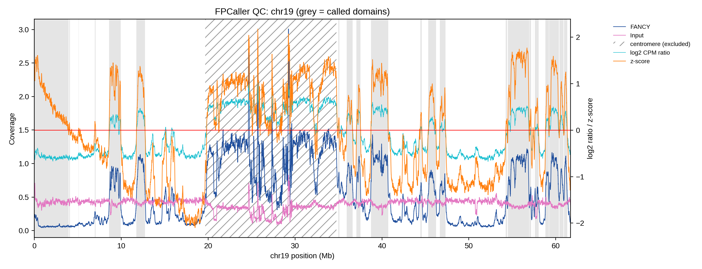

# FPCaller


**FPCaller** calls broad chromatin domains enriched in FANCY-sorted DNA-seq compared with a matched input. Examples are nucleolus-associated domains (NADs) from nucleolar sorts and speckle-associated domains (SADs) from nuclear-speckle sorts.

It takes two binned coverage bedGraphs (FANCY and input) and returns a BED file of enriched domains, summary statistics and a QC plot.


*HCT116 NPM1-antibody nucleolar sort, chr19 (bundled test data). Grey: called domains. Hatched: centromere interval excluded by the filter.*

## Installation

```bash
git clone https://github.com/alexpmagalhaes/FPCaller.git
cd FPCaller
pip install .            # or: pip install ".[test]" to also get pytest
```

Requirements: Python ≥ 3.9, numpy, pandas, matplotlib.

## Quick start

```bash
fpcaller --fancy FANCY.bedgraph --input INPUT.bedgraph --sample my_sample
```

Run on the bundled test data:

```bash
bash examples/run_example.sh
```

## Input

Two 4-column bedGraphs (`chrom  start  end  value`), plain or gzip-compressed, with **identical binning**. Only bins present in both files are used. Example of how they can be made with deepTools:

```bash
bamCoverage -b FANCY.bam -o FANCY.bedgraph -of bedgraph --binSize 1000 --smoothLength 50000 -p 8
bamCoverage -b INPUT.bam -o INPUT.bedgraph -of bedgraph --binSize 1000 --smoothLength 50000 -p 8
```

The FANCY study used 1 kb bins with 50 kb smoothing (`*.w50k_b1k.bedgraph`), aligned to T2T-CHM13 v2.0.

## Method

For each sample:

1. **Chromosome filter:** keep autosomes (`chr1`–`chrN`; change with `--chrom-regex`).
2. **log2 CPM ratio, per chromosome:** `log2((FANCY+1)/Σ(FANCY+1)) − log2((INPUT+1)/Σ(INPUT+1))`.
3. **Baseline correction:** for each chromosome, fit a polynomial (degree 3) of the ratio against position and subtract it. This removes arm-scale trends.
4. **Smoothing:** rolling mean over 5 bins.
5. **z-score:** genome-wide (population SD).
6. **Domain calling:** contiguous bins with z ≥ 0, longer than 2,001 bp (≥ 3 bins at 1 kb).
7. **Centromere filter:** remove domains overlapping a centromere (`--genome chm13` default, `hg38`, or `none`).

## Output

| File | Content |
|------|---------|
| `<sample>.bed` | domains (chrom, start, end) |
| `<sample>.stats.tsv` | number of domains, total bp, mean size, N10/N50/N90, mean inter-domain distance |
| `<sample>.<chrom>_qc.{svg,png,pdf}` | QC plot of one chromosome (`--plot-chrom`, default chr14) |
| `<sample>.zscore.bedgraph`, `<sample>.corrected_log2ratio.bedgraph` | per-bin tracks (with `--write-signal`) |

## Options

```
-f/--fancy, -i/--input, -s/--sample   required
-o/--outdir        output directory (default .)
-g/--genome        chm13 | hg38 | none (default chm13)
--chrom-regex      chromosomes to analyse (default '^chr\d+$')
--poly-degree      baseline polynomial degree (default 3)
--smooth-bins      rolling-mean window in bins (default 5)
--min-length       keep domains longer than this, bp (default 2001)
--plot-chrom       chromosome for the QC plot or 'none' (default chr14)
--write-signal     write per-bin bedGraph tracks
--legacy           reproduce the original FPCaller.py exactly
```

## Python API

```python
from fpcaller import run_fpcaller

res = run_fpcaller("FANCY.bedgraph", "INPUT.bedgraph", genome="chm13")
res.domains      # DataFrame: Chromosome, Start, End
res.signal       # per-bin table with ratio, corrected ratio and z-score
res.stats        # dict of summary statistics
```

Each step (`read_bedgraph`, `log2_cpm_ratio`, `baseline_correct`, `zscore`, `call_domains`, `filter_centromeres`) can also be called on its own.

## Legacy mode

Default mode fixes three edge effects of the original `--legacy` has: the dropped first bin, the rolling mean crossing chromosomes, and the loss of domains that reach chromosome ends. See `CHANGELOG.md`.

## Notes and limitations

- **Chromosome ends:** the cubic baseline can bend at chromosome ends and give positive z-scores where FANCY is not above input (e.g. chr19 0–4 Mb in the example). Check domains at chromosome ends in the QC plot.
- **Other genomes:** only CHM13 and hg38 centromeres are built in. For other genomes, use `--genome none` and filter afterwards with `bedtools intersect -v`, or add coordinates to `src/fpcaller/centromeres.py`.

## Tests

```bash
pip install ".[test]"
pytest
```

Test data: chr19 of the HCT116 NPM1-antibody nucleolar FANCY sort (replicate 1) and its input, from the FANCY study (GEO: GSE353840).

## Citation

If you use FPCaller, please cite: *FANCY study, TBD.*

## License

GPL-3.0. See `LICENSE`.
